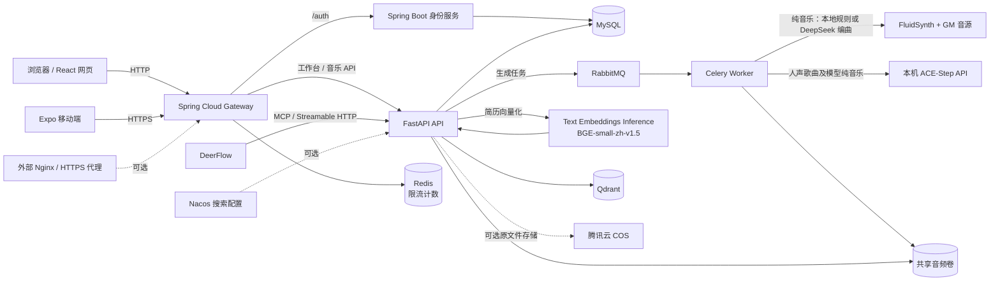

# Music Agent 项目总结

## 项目概览

Music Agent 是一个面向音乐创作与效率场景的工作台。项目将网页入口、账号与会话、音乐业务 API、异步生成、简历语义检索和 Agent 工具接入组合为一套可本机运行、可部署到服务器的服务。

## 已实现的能力

- **音乐工作台**：搜索 Apple Music 曲目；可选接入 Navidrome 自有曲库；管理歌单、创作对话、生成任务与作品标签。
- **音乐创作与生成**：DeepSeek 协助创作；纯音乐默认可交给 ACE-Step 生成，也可使用本地规则编曲并通过 FluidSynth 渲染 WAV；人声歌曲须先完成并确认歌词，再交给 ACE-Step 生成。
- **简历工作台**：上传 PDF、DOCX、TXT、MD，切分材料并建立语义索引；根据岗位描述检索个人经历并生成匹配分析。可选将原始文件保存到腾讯云 COS。
- **账号与访问控制**：支持注册、登录和会话管理；生成任务、歌单、创作对话和个人简历材料按用户隔离。
- **MCP 接入**：后端通过 MCP 暴露音乐搜索、歌单和创作相关工具，供 DeerFlow 调用。
- **多端入口**：React 网页端；另有 Expo React Native 移动端工程，可连接已部署的 HTTPS 服务。
- **本地与服务器部署**：Docker Compose 编排服务，通过环境变量文件区分本地开发和 Ubuntu 测试环境。

## 架构图

## 关键选型与原因

| 选型 | 项目用途 | 选择原因 |
|---|---|---|
| **FastAPI + Python** | 音乐、简历与 MCP API | 音乐生成和模型集成主要在 Python 生态中；开发 HTTP 接口、调用模型和处理文件方便。 |
| **Spring Cloud Gateway** | 统一入口、路由、登录验证和限流 | 网页与移动端只访问一个入口；内部 API 不直接映射宿主机端口，也便于集中执行身份检查。 |
| **独立 Spring Boot 身份服务** | 注册、登录和会话 | 将账号与会话职责从音乐业务中拆分；音乐 API 保持 Python 实现，不必为认证迁移整套后端。 |
| **MySQL** | 用户、会话、任务、歌单、对话和简历元数据 | 这些数据有明确关系和状态，需要事务、查询和持久化；共用关系数据库可减少运维组件。 |
| **RabbitMQ + Celery** | 后台生成任务 | 音乐生成耗时较长，API 可以快速受理并返回任务状态，Worker 在后台处理；队列可以保存等待中的任务。 |
| **Redis** | Gateway 限流计数 | 参与登录防护：`/auth/**` 按来源 IP 限流；通过认证的音乐 API 请求按用户限流。它不保存登录会话。 |
| **Qdrant + BGE Embedding 服务** | 简历片段语义检索 | 向量检索能按语义找到相关经历，而不局限于岗位描述和简历使用了相同关键词。Embedding 服务独立运行，供 API 调用。 |
| **本机 ACE-Step API** | 人声歌曲和模型纯音乐生成 | 模型在本机 GPU 上运行，Worker 通过宿主机地址调用；模型环境与 Docker 服务分开，也可以针对本机显存启用 CPU 卸载。 |
| **FluidSynth + GM 音源** | 纯音乐 WAV 渲染 | 纯音乐可由 Worker 本地编曲和渲染，不必依赖 ACE-Step 人声生成服务。 |
| **React + Vite** | 网页界面 | 负责工作台交互；构建后的静态资源随 API 镜像部署，少维护一个单独的网页服务器。 |
| **Docker Compose** | 本机和测试环境编排 | 将 Gateway、身份服务、API、Worker、数据库、队列和向量库放在一套配置中；用环境文件选择不同环境参数。 |
| **MCP** | DeerFlow 与音乐能力的接口 | Agent 可以调用已有的搜索、歌单和创作能力，不必把业务逻辑复制到 DeerFlow。 |

以上选型理由根据项目当前服务边界和使用方式归纳。

## 为什么选这些，而不是其他方案

本项目没有保存一份逐项的选型评测报告。下面分两类说明：配置和代码能直接确认的内容，以及根据当前规模、目标和实现方式推导出的取舍。这里的“为什么”是工程判断，不代表做过正式的性能基准对比。

### 简历检索：BGE-small-zh-v1.5 + TEI + Qdrant

**为什么选 BGE-small-zh-v1.5。** 目前简历与岗位描述主要是中文，检索语料是用户自己的简历和经历材料，规模预期也远小于通用企业搜索。小型中文向量模型部署成本低、CPU 推理可用，适合先把端到端 RAG 流程落地。当前实现使用 512 维向量；岗位查询会加中文检索指令，简历片段不加该指令。

**与 Qwen3-Embedding-0.6B 等较大型 Embedding 模型相比。** 更大的模型可能在跨语言、复杂语义和广泛任务上表现更好，但也通常需要更多内存、磁盘和推理时间。对中文简历匹配的小语料来说，是否值得增加本地资源开销，需要拿真实简历和岗位描述做 Recall@K、人工相关性等评测后才能确定。当前代码选择 BGE；`models/` 中存在其他模型文件，不表示它们已接入当前 Compose 流程。

**与云端 Embedding API 相比。** 云服务减少本机模型维护，但简历文本需要发送到外部供应商，且会引入网络、费用和密钥依赖。简历属于个人敏感材料，所以当前采用本地推理服务，数据不必为生成向量而发到第三方 API。

**为什么用独立的 Hugging Face Text Embeddings Inference（TEI）服务。** API 用 HTTP 调用 `/embed`，模型进程与 FastAPI 分开。这样可以独立替换或升级模型，不必把 PyTorch/模型运行时塞进 API 镜像，也避免 API 和 Worker 各自加载一份模型。代价是多一个需要启动和监控的容器；当前 Compose 使用 CPU 镜像，换成 GPU 推理需要另行调整部署配置。

**为什么用 Qdrant。** 当前核心需求是按向量相似度检索简历片段，并通过 point ID 与 MySQL 中的用户、文件名和文本片段关联。Qdrant 专注向量集合、相似度和 payload 过滤，服务模型简单，适合当前规模。

与其他检索方案的取舍：

- **MySQL 全文或 LIKE 搜索**：部署组件少，但主要匹配词面，不擅长找到“负责客户留存”和“降低流失率”这种说法不同、意思相近的内容。
- **把向量也放进关系数据库**：减少一个服务，但会让向量索引和相似度检索依赖数据库能力及版本；当前项目把业务状态放 MySQL、语义搜索放 Qdrant，职责更清楚。
- **Elasticsearch / OpenSearch**：适合同时做全文、过滤和规模更大的搜索集群，但对目前的简历 RAG 会增加部署和维护面。
- **Milvus**：面向更大规模的向量检索和扩展场景；当前简历工作台尚不需要为大规模集群复杂度付出成本。

这些选择应随着真实检索效果和数据量复评。特别是 BGE 与更大模型的质量差异，不能仅凭模型大小推断，需用项目语料实测。

### 业务 API：FastAPI + Python，而不是统一改成 Java 或 Node

音乐生成、文本处理和模型调用都能直接使用 Python 生态。选择 FastAPI 可快速定义输入校验、异步 HTTP 接口，并让 API 和 Celery Worker 共享 Python 业务代码。项目中 Java 用于 Gateway 和认证，Python 用于音乐与 RAG，使语言跟职责匹配。

如果所有服务统一为 Java，部署语言会更统一，但音乐/机器学习相关依赖的接入与维护成本可能增加；Node 也可提供 API，但本项目的 MIDI、音频处理和模型集成仍更贴近 Python。当前是多语言服务，换来职责匹配，也承担了两套构建与运行环境的维护成本。

### Gateway 与身份：拆成两个 Spring 服务

**Gateway 而不是让 FastAPI 直接对外。** Gateway 统一转发网页、移动端、认证和音乐 API 请求，并集中执行会话验证与 Redis 限流。API 只在 Compose 网络内开放，降低业务容器直接暴露的面。代价是多一个需要构建、启动和排查的 Java 服务；单用户原型可直接由 API 对外服务，但平台有账号隔离和多个入口后，统一入口更容易管理。

**独立 Auth 服务而不是把登录写进音乐 API。** 登录、注册、Cookie 和会话生命周期与音乐生成业务变化不同，拆开后边界清晰；它们仍共用 MySQL，减少数据库种类。代价是每个受保护请求要通过 Gateway 查询会话，并需要维护 Java 与 Python 两侧的用户身份约定。

**服务端会话而不是自包含 JWT。** 登录 Cookie 中放随机会话令牌，数据库只存 SHA-256 摘要。服务端可以查到期时间并立即撤销会话，浏览器 Cookie 可设为 HttpOnly、SameSite=Lax。JWT 可以减少每次查库，但立即撤销和权限变更通常需要额外机制。当前系统规模下，数据库会话的简单撤销能力更合适。

**Redis 限流而不是只靠进程内计数。** Redis 让限流状态可被 Gateway 实例共享；本地内存计数在多实例时会分散。Redis 因此成为额外依赖，但限流可以按来源 IP 或已认证用户进行。

**Redis 确实参与登录相关处理，但它不是登录态存储。** Gateway 对 `/auth/**` 配置了 Redis 限流；该路径在认证前可访问，因此限流键解析为请求来源 IP，用于减缓单一来源的高频认证请求。已认证的音乐 API 请求则使用用户 ID 作为限流键。真正的会话令牌摘要、用户关联和到期时间保存在 MySQL 的 `music_sessions` 表；每次受保护请求由 Gateway 调用 Auth 服务验证会话。换句话说，Redis 管“请求频率”，MySQL 管“谁登录了以及会话是否有效”。

### 数据存储：MySQL、RabbitMQ 与音频卷各司其职

**MySQL 负责业务事实。** 账号、会话、生成任务状态、歌单和创作对话都需要结构化查询与事务。PostgreSQL 也是可行方案，但项目已采用 MySQL，并没有当前必须依赖 PostgreSQL 才能满足的功能；同时再维护两种关系库没有明显收益。

**RabbitMQ + Celery 而不是同步生成或仅用 Redis 队列。** 模型生成可能运行数分钟，HTTP 请求不适合一直等待；任务入队后 API 可返回 ID，前端查询状态，Worker 独立消费。RabbitMQ 的确认、持久化队列、死信和 Celery 任务模型适合这类后台工作。Redis 队列组件可能更少，但本项目需要清晰的消息投递与失败处理；同步调用则会占用连接并更容易遇到代理超时。代价是 RabbitMQ 与 Celery 都需要运维，并处理任务重复投递和幂等性。

**共享音频卷而不是把音频放数据库。** 音频是较大的二进制文件，卷适合 Worker 写入、API 读取；MySQL 只记录任务和元数据。若将来多主机部署或需要外部交付，音频卷可替换或扩展为对象存储。

### 音乐生成：ACE-Step 与 FluidSynth 分工

**人声歌曲用本地 ACE-Step API。** 项目需要根据已确认的歌词生成完整人声歌曲；本机部署使生成模型由使用者掌控，也避免每次生成都依赖某个托管生成 API。代价是首次下载体积大、显存/内存压力高、生成速度受本机硬件影响，也要单独管理模型环境。由 Worker 经 `host.docker.internal` 调用，是为了让 Docker 中的业务服务连接本机模型进程；这条路径依赖 ACE-Step 窗口和 `8001` 端口可用。

**纯音乐支持模型生成和本地程序化编曲。** ACE-Step 可生成完整录音；本地 MIDI + FluidSynth 路径能明确控制音符、乐器、节奏和时长，可在 CPU 上运行。GM 音源听感受限；DeepSeek 可选地规划逐小节编曲，本地规则提供无密钥路径。ACE-Step 路径需要本机模型服务运行并占用 GPU/内存。

### 前端和部署：React/Vite、Expo 与 Compose

**React + Vite 网页，而不是服务端模板。** 音乐工作台有对话、轮询进度、标签编辑和试听等动态交互，React 管理界面状态方便。Vite 构建后静态文件由后端镜像提供，部署拓扑仍保持简单。代价是增加 Node 构建步骤和前端依赖。

**Expo React Native，而不是从零分别写 Android 与 iOS 原生应用。** 一个 JavaScript/React Native 工程可以复用主要界面和业务调用，缩短双平台试用路径。原生音频、签名、商店发布仍需处理；如果大量依赖平台原生功能，原生分别开发会有更高的控制力。

**Docker Compose，而不是 Kubernetes。** 项目当前面向单机本地开发和单台测试服务器；Compose 足以启动依赖服务、配置网络和持久卷，开发者不需要先维护集群。它不提供 Kubernetes 那类多节点调度与弹性扩缩容能力，未来多主机或高可用部署需要重新评估编排平台。

**本地模型和外部 SaaS 的折中。** BGE 与 ACE-Step 在本机运行，降低敏感材料和生成请求对托管模型服务的依赖，但由本机承担磁盘、显存和维护工作。DeepSeek 是可选的外部文本模型，用来避免为了创作对话或编曲规划再维护一套本地 LLM；使用它需要网络、API 密钥，并按供应商规则处理发送内容和费用。

### 外部集成为什么做成可选

- **COS** 用来保存原始简历文件，适合部署环境需要独立、持久文件存储的情况；本地文件或仅保存文本索引更容易启动，但不提供同等的对象存储管理能力。密钥和对象权限也需要额外管理。
- **Nacos** 能在运行中调整搜歌超时，适合已有 Nacos 配置平台的部署；当前只有少量参数，环境变量和默认值更简单，所以不把 Nacos 设为必需服务。
- **Navidrome** 面向用户已有的音乐库。默认使用 Apple Music 公开目录可以免去自建曲库服务；Navidrome 保留为可配置搜索来源。

## 哪些选型值得用数据重新验证

1. 用真实岗位与简历样本比较 BGE-small-zh-v1.5 和 Qwen3-Embedding-0.6B 的前 K 条相关性、中文专业术语召回率、CPU 延迟和内存占用。
2. 记录简历条目数、向量点数和检索延迟；若规模增长，再比较 Qdrant 与更完整的搜索平台。
3. 记录 ACE-Step 不同模型配置下的生成耗时、峰值显存、失败率和音质评价，确认硬件配置是否适合日常使用。
4. 当 API、Worker 或存储转为多主机部署时，重新评估 Compose、共享音频卷和模型服务的部署边界。

## 关键业务流程：人声歌曲生成

1. 用户在网页或移动端登录，通过 Gateway 访问音乐工作台。
2. 创作助手与用户打磨歌词；用户确认歌词后，前端才提交人声歌曲任务。
3. FastAPI 保存任务状态，并将生成工作投递到 RabbitMQ。
4. Celery Worker 领取任务，调用本机 ACE-Step API。
5. Worker 将完成的音频写入共享卷，并更新 MySQL 中的任务状态。
6. API 返回任务状态和音频访问地址，工作台展示进度并提供试听。

纯音乐可走两条路径：ACE-Step 模型生成完整音频，或由 Worker 使用本地规则/DeepSeek 生成编曲，再通过 FluidSynth 渲染音频。

## 关键业务流程：简历匹配

1. 用户上传简历或经历文件，API 提取文本并拆分为片段。
2. Embedding 服务将片段转换为向量，API 将向量和元数据保存到 Qdrant 与 MySQL。
3. 用户提交岗位描述后，系统进行语义检索，取回相关经历片段。
4. 后端基于检索结果生成岗位匹配分析；原始文件可以按配置额外保存到 COS。

## 数据与安全边界

- Gateway 是外部 HTTP 流量的统一入口；API 只在 Compose 内部网络开放。
- 登录会话使用 `HttpOnly`、`SameSite=Lax` Cookie；数据库保存会话令牌的 SHA-256 摘要。
- Gateway 验证会话后设置用户身份头，后端据此执行用户级数据隔离。
- 密钥放在本机 `.env.local` 或服务器 `.env.test`，不应提交到 Git。
- MySQL、RabbitMQ、Redis、Qdrant 和生成音频使用独立持久化卷。

## 可选集成与当前范围

- **Navidrome**：配置后可将自有曲库作为搜歌来源；默认搜索 Apple Music 公开目录。
- **腾讯云 COS**：配置桶和权限后，用于保存简历原文件；不配置时仍可使用现有本地索引流程。
- **Nacos**：可集中调整搜歌超时；未配置时使用服务默认值。
- **DeepSeek**：用于创作对话或纯音乐编曲规划；密钥留空时纯音乐可走本地规则。
- **DeerFlow**：通过 MCP 调用 Music Agent 工具，需要在 DeerFlow 侧配置扩展。
- **移动端**：项目提供 Expo 客户端工程；生成 Android/iOS 安装包仍需要相应构建账号和平台签名配置。

作品标签支持按账号记录风格、BPM、情绪和使用场景等信息。当前项目没有接入自有原始音频素材、stem/sample 管理或模型训练/微调流程。

## 主要目录

| 目录 / 文件 | 内容 |
|---|---|
| `frontend/` | React + Vite 网页端 |
| `backend/` | FastAPI、音乐业务、简历检索、MCP 和 Worker 代码 |
| `gateway-service/` | Spring Cloud Gateway |
| `auth-service/` | Spring Boot 注册、登录与会话服务 |
| `mobile/` | Expo React Native 客户端 |
| `deerflow/` | DeerFlow MCP 配置示例和 Skills |
| `compose.yaml` | 本地与测试服务编排定义 |
| `README.md` | 本地启动、模型安装和服务器部署说明 |

## 部署与后续维护提示

- 本机首次启动需要准备 `.env.local`、BGE 模型、ACE-Step 环境和 Docker Desktop；ACE-Step 模型首次运行还可能下载模型文件。
- ACE-Step 在本机独立运行，服务地址为 `8001`；Music Agent 通过 `host.docker.internal` 访问它。关闭 ACE-Step 窗口会使人声歌曲和 ACE-Step 纯音乐生成暂时不可用；本地纯音乐仍可使用。
- 修改 Java 或 Python 代码后需要重建对应 Docker 镜像；未修改代码时可直接启动已构建镜像，避免重复 Maven 打包。
- 本地与服务器使用不同 Compose 项目名和环境变量文件，避免开发数据卷与测试环境互相覆盖。
